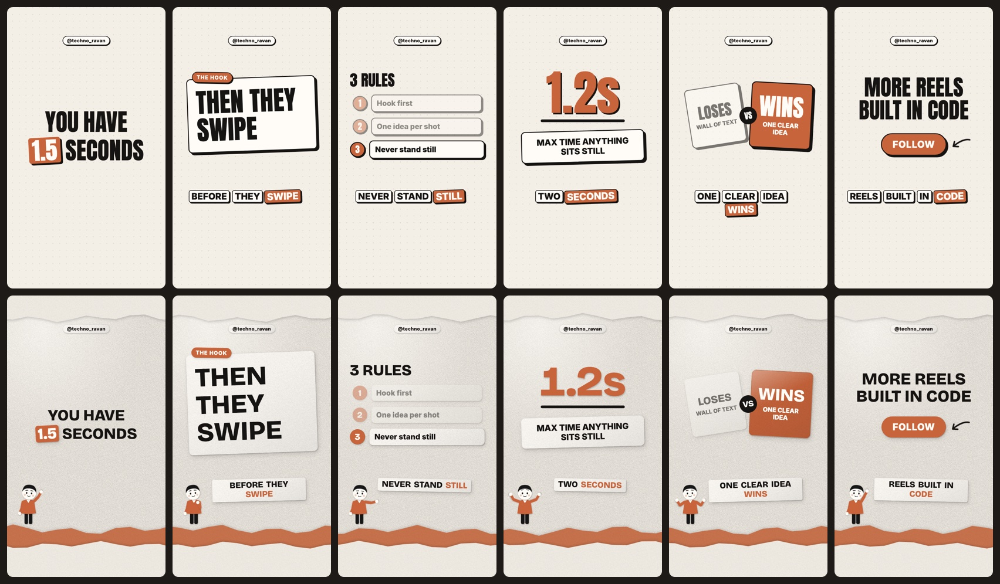

# 🎬 Techno Reel

**Turn an idea or recording into a finished reel with your AI assistant.**

Get a vertical **1080×1920 MP4**, custom cover poster and platform captions, with animated scenes, word-by-word captions, and background music. Built on curated styles (`flat`, `print`) and palettes (`clay`, `cobalt`, `forest`, `mono`), featuring our signature **Flat Clay** channel standard. Everything renders locally on your Mac.



## Get started

You need a **Mac**, **Node.js 22.18+**, **Git** and an AI coding assistant
such as Claude Code, Codex, Cursor or Gemini CLI. Local voice requires **Apple Silicon**.

### 1. Install

```bash
git clone https://github.com/Nayan014/techno-reel.git
cd techno-reel
npm run setup
```

Setup installs the tools and local VoiceStudio engine. Allow a few minutes and several
GB for voice models. You can safely rerun setup if a download fails.

Just want to try the included example? Use `npm run setup -- --render-only`, then
`npm run render -- example`.

### 2. Ask for a reel

Open this folder in your AI coding assistant and say:

```text
Make a reel about 3 AI coding rules, under 25 seconds.
My handle is @techno.
```

Choose **Auto** or **Plan**:
- **Auto**: The assistant runs autonomously end-to-end at full speed, picking the optimal theme, music, and layout, and delivers the finished MP4, cover, and post captions.
- **Plan**: Collaborative review mode. Review and approve the visual theme, thematic background artwork, storyboard cards, and real shot frames before anything is voiced or rendered.

To edit your own recording into a talking-head reel, give the assistant its video file path instead.

### 3. Review and refine

Your video, cover and caption are in `projects/<slug>/export/`.
Ask for changes in the same chat: `Make the hook punchier` or `Use print style`.

To browse your projects:

```bash
npm run dashboard
```

Open [the dashboard](http://127.0.0.1:4173) for previews and settings.
Feedback and approvals happen in your AI chat.

## Make it yours

Use these guides when you want to change something:

| I want to… | Guide |
| --- | --- |
| Create a cartoon presenter from my photo | [Avatar](docs/avatar.md) |
| Choose a voice, clone mine or use another language | [Voice](docs/voice.md) |
| Set defaults for style, colours, music and handle | [Dashboard and settings](docs/dashboard.md) |
| Explore reel types and Auto / Plan modes | [Reel workflow](docs/workflow.md) |
| Edit scripts, build scenes or run commands myself | [Customization and commands](docs/customization.md) |
| Publish to Instagram or YouTube | [Publishing](docs/publishing.md) |
| Fix setup or upgrade an older installation | [Help](docs/help.md) |

Something not working? Run `npm run doctor` to check your setup.

[Contributing](CONTRIBUTING.md) · [Assistant workflow](CLAUDE.md) ·
[Privacy and licences](docs/privacy.md) · [MIT licence](LICENSE)

---

**Know someone with ideas for reels?** Share [Techno Reel](https://github.com/Nayan014/techno-reel).
If you make something with it, tag **[@techno_ravan](https://www.instagram.com/techno_ravan/)** —
I'd love to see it. A GitHub star helps others discover the project.

Made by **[Nayan Vekariya](https://vekariya.ai.studio/)** ·
[Techno Ravan on YouTube](https://www.youtube.com/@techno_ravan) ·
[Instagram](https://www.instagram.com/techno_ravan) ·
[LinkedIn](https://www.linkedin.com/in/nayan-vekariya/)
