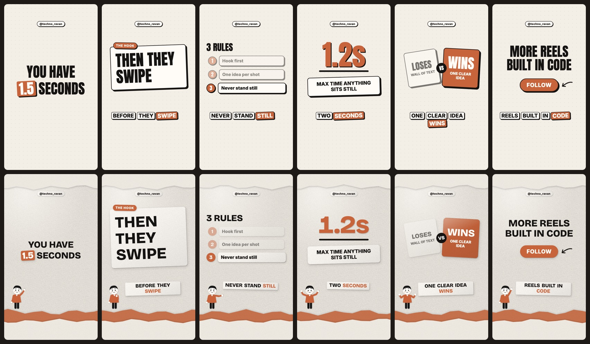
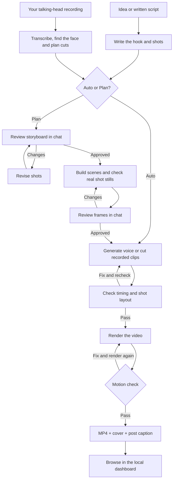
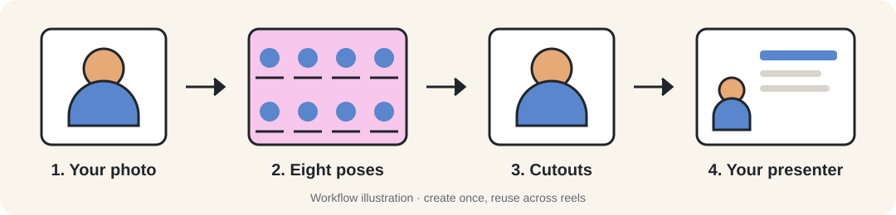

<div align="center">

# 🎬 Techno Reel

**Turn one idea into a finished Instagram reel.**

Describe your reel in an AI coding chat. Techno Reel gives your assistant the tools to
write it, voice it, animate it and export it on your Mac.

**One prompt → script → voice → animation → captions → MP4**

[MIT](LICENSE) · React + Remotion · Local rendering

[Quick start](#quick-start) · [Workflow](#how-the-workflow-works) · [Your avatar](#create-your-own-avatar) · [Voice](#voice-text-to-speech-and-cloning) · [Reel types](#what-can-you-make) · [Dashboard](#review-your-projects) · [Under the hood](#under-the-hood)



Two looks: **flat** (bold outlines) and **print** (cut-paper cards and a presenter).

</div>

An open-source video toolkit for creators explaining ideas, developers sharing demos, and
people turning recordings into short videos. Your AI coding assistant runs the workflow;
React and Remotion build the scenes and render the video locally.

You get a **1080×1920 MP4**, a **cover image** and a **post caption**, with word-by-word
captions, sound effects and optional music. Reels typically run 20–45 seconds.

## Quick start

**You need:** a Mac (Apple Silicon for the free local voice), [Node.js](https://nodejs.org) **22.18 or newer**
(check with `node -v`; install with `brew install node`, or `nvm use` for the pinned version),
Git, and an AI coding assistant such as Claude Code, Gemini CLI, Codex or Cursor.

**1. Install and render the example.** About a minute, no voice engine:

```bash
git clone https://github.com/Nayan014/techno-reel.git
cd techno-reel
npm run setup -- --render-only
npm run render -- example
open projects/example/export/example.mp4
```

**2. Add the voice** for your own reels:

```bash
npm run setup
```

This installs [VoiceStudio](https://github.com/debpalash/VoiceStudio), a free local voice
engine, and its model: several GB, a few minutes, once. It uses [Homebrew](https://brew.sh)
to install `uv` if you don't have it. Setup is safe to re-run; it keeps your `.env`, packages
and downloads. Prefer ElevenLabs or macOS `say`? See [other voice providers](#other-voice-providers).

**3. Make your first reel.** Open this folder in Claude Code, Gemini CLI, Codex or Cursor and ask:

```text
Make a reel about 3 sleep tips, print style, cobalt palette,
my handle is @sleepbetter, under 25 seconds.
```

Choose how much you want to review:

| Mode | What happens |
| --- | --- |
| **Auto** | The assistant writes, voices, animates and checks the reel, then exports it. |
| **Plan** | Review the storyboard, then real shot stills. Voice and final rendering wait for your approval. |

Find the finished files in `projects/<slug>/export/`. To revise them, tell your assistant:
`In sleep-tips, make the hook punchier`.

Something not working? `npm run doctor` checks every piece and says how to fix what's missing.
Want to drive it by hand? See [Under the hood](#under-the-hood).

## How the workflow works

Start with an idea, a script or your own recording. Your AI assistant runs the steps;
in Plan mode, you review the storyboard and real frames before production continues.



In Plan mode, talking-head clips are cut before frame review so previews use your actual
footage. Generated voice waits for frame approval. If a fix changes an approved shot,
the assistant brings its updated frames back for review before rendering.

## Create your own avatar

Give your reels a cartoon presenter based on you. It changes pose between shots and animates
its mouth with the voice. Set it up once and reuse it in either visual style.



**1. Make the character sheet.** Ask your assistant: `Help me create my own cartoon host`.
It gives you a prompt to use with a clear, front-facing photo in an image service of your choice.
The result should be one **4×2 sheet of eight poses**, with a closed mouth and a solid magenta
background. The poses are idle, pointing, presenting, thinking, shrugging, shocked, cheering
and waving. You choose where to upload your photo.

**2. Import the sheet.** Save the full-size image locally and give your assistant its path:

```bash
npm run host -- /path/to/character-sheet.png
```

The tool removes the magenta and saves the poses in `.local/host/`. Your assistant checks the
cutouts and adjusts mouth positions using `.local/cache/host/check.png`.

**3. Use your presenter.** Ask: `Use my cartoon host in this reel`. The assistant sets
`"host": "character"` in the reel's script and checks the result in the shot previews.

The avatar is a cartoon with animated poses and a mouth overlay. Its appearance and voice
are configured separately; to use your voice too, see cloning below.
Your character files stay in `.local/host/`, which is ignored by Git.

For the full image prompt and pose setup, see the [cartoon-host guide](.claude/skills/cartoon-host/SKILL.md).

## Voice: text-to-speech and cloning

### Text-to-speech

The default is **Kokoro / af_heart**, running locally through VoiceStudio on Apple Silicon.
It starts automatically when needed. Write a script, and the workflow generates speech and
word timings for captions. No voice cloning is needed to get started.

Change the preset in `.env`, then ask your assistant to record the reel again:

```dotenv
VOICE_PROVIDER=voicestudio
VOICESTUDIO_MODEL=mlx-audio
VOICESTUDIO_VOICE=af_heart
```

Ask for delivery changes in chat: `Pause before the payoff in shot 3` or
`Say the last two words more slowly`. Delivery marks stay out of the captions.

### Voice cloning and other languages

The default Kokoro setup does **not** clone voices or support German. The repository's
VoiceStudio integration also supports **OmniVoice**, which adds those capabilities.

1. Set up OmniVoice in VoiceStudio and personally review and accept its **non-commercial licence**.
2. Create a saved voice profile in VoiceStudio using your reference recording.
3. Set the model and saved profile in `.env`:

```dotenv
VOICESTUDIO_MODEL=omnivoice
VOICESTUDIO_VOICE=your-saved-profile-name-or-id
VOICESTUDIO_LANGUAGE=de
```

Use the language code for your reel; `de` is the German example. Model setup and licence
acceptance happen in VoiceStudio. Ask your assistant for help with your installation.

### Other voice providers

Pick one with `VOICE_PROVIDER` in `.env`, then run `npm run setup`; it skips VoiceStudio for
the others. Setup creates `.env` on its first run, or copy it yourself: `cp .env.example .env`.

| Provider | What you need |
| --- | --- |
| **VoiceStudio** (default) | Apple Silicon for local MLX voice. Full setup installs it. |
| **ElevenLabs** | `VOICE_PROVIDER=elevenlabs`, `ELEVENLABS_API_KEY` and `ELEVENLABS_VOICE_ID`. Paid cloud service. |
| **macOS say** | `VOICE_PROVIDER=say`. Built-in voice with estimated caption timing. |

Providers never switch automatically. Intel Macs need an alternative to local MLX voice;
the full Windows/Linux workflow is unverified. See [.env.example](.env.example) for all settings.

## What can you make?

| Reel type | What it looks like | Try asking |
| --- | --- | --- |
| **Paper-style explainer** | Cut-paper cards, textured backgrounds and a paper presenter. | `Explain 3 sleep tips in print style` |
| **Bold animated reel** | Big headlines, hard shadows, numbers, lists and comparisons. | `Make a flat-style reel comparing two ideas` |
| **Talking head** | Your recording, trimmed and reframed, with captions and supporting graphics. | `Edit ~/Downloads/my-video.mov into a reel` |
| **Avatar-led reel** | Your custom cartoon presenter alongside animated scenes, in either style. | `Make an explainer with my cartoon host` |
| **Demo or walkthrough** | Your screenshots alongside headlines, steps and voiceover. | `Use these screenshots to explain my app` |

**Styles and presenters work together:** `flat` and `print` control the visual design;
a custom avatar replaces the presenter in either style. The print style includes a paper host
by default, which you can hide.

Talking-head edits use your spoken words, trim fillers and retakes, and alternate face shots
with graphics. Transcription requires VoiceStudio; Homebrew ffmpeg adds noise reduction.

Personalise any reel with **clay, cobalt, forest or mono** colours, your @handle, and
**lofi, upbeat, chill or funk** music. Ask for `no music` if you will add audio on Instagram.
The assistant checks timing, shot layout and motion during production.

## Review your projects

```bash
npm run dashboard
```

Open [the local dashboard](http://127.0.0.1:4173) to browse storyboards, stills, videos,
captions and saved checks. It refreshes every five seconds and flags outdated outputs.
**Production, feedback and approvals happen in your AI chat.**

```text
projects/<slug>/
  raw/          Untouched source recordings
  working/      Script, voice, assets and custom scenes
  preview/      Storyboard, stills and draft
  export/       <slug>.mp4, cover.png and caption.txt
```

## Under the hood

The assistant has no hidden powers: every step it takes is a plain npm script you can run,
read and change yourself. No AI needed.

### Make a reel by hand

```bash
npm run project -- my-reel
cp examples/example/script.json projects/my-reel/working/
# edit projects/my-reel/working/script.json
npm run voice -- my-reel
npm run check -- my-reel
npm run stills -- my-reel
npm run render -- my-reel
```

A reel is one `script.json`: a few top-level choices and one entry per shot.

```json
{
  "title": "You have 1.5 seconds",
  "style": "print",
  "palette": "clay",
  "handle": "@yourhandle",
  "music": "upbeat",
  "shots": [
    {
      "id": "01",
      "say": "You have | *one and a half seconds.*",
      "scene": "Hook",
      "captions": false,
      "props": { "lines": ["You have", "1.5 seconds"], "highlight": "1.5" }
    }
  ]
}
```

- `style`: `flat` or `print` · `palette`: `clay`, `cobalt`, `forest`, `mono` ·
  `music`: `lofi`, `upbeat`, `chill`, `funk`, or leave it out.
- `say` is spoken and captioned. `|` adds a beat, `||` a long pause, `*words*` are said heavy.
- `scene` is one of `Hook`, `Statement`, `Stamp`, `ChatPrompt`, `BigNumber`, `List`, `Compare`,
  `Meter`, `Swarm`, `Screenshot`, `CTA`. Their props are in the
  [scene reference](CLAUDE.md#scenes).
- Talking heads add `"take": "take.mp4"`, and each shot a `clip: [in, out]` and a `layout`.

### Every command

| Command | What it does |
| --- | --- |
| `npm run project -- <slug>` | Create `projects/<slug>/` |
| `npm run voice -- <slug>` | Record every line (unchanged lines are cached) and time its words |
| `npm run check -- <slug>` | Pace gate: hook length, words per second, reel length. Renders nothing |
| `npm run plan -- <slug> [--frames]` | Storyboard page at `preview/plan.html`; `--frames` adds real stills |
| `npm run stills -- <slug> [--shot=03]` | One PNG per shot, taken just before its cut |
| `npm run render -- <slug> [--draft]` | Final MP4 and cover; `--draft` is half size and fast |
| `npm run pace -- <slug> [--draft]` | Motion gate: flags anything still for over 1.2 s |
| `npm run studio -- <slug>` | Scrub and inspect the reel in Remotion Studio |
| `npm run dashboard` | Read-only overview of every project at `127.0.0.1:4173` |
| `npm run transcribe -- <slug> <video>` | Talking head: level, denoise and transcribe your recording |
| `npm run host -- <sheet.png>` | Cut a cartoon pose sheet into your presenter |
| `npm run sfx` | Re-download and master the sound effects and music |
| `npm run doctor [-- --render-only]` | Check the setup and say how to fix what's missing |
| `npm test` · `npm run typecheck [-- <slug>]` | Kit tests; TypeScript for the kit and a reel's custom scenes |

### Make it yours

| To change | Edit |
| --- | --- |
| Voice, engine, speed, language | `.env` (every setting is explained in [.env.example](.env.example)) |
| Colours, styles, Instagram safe area | `src/theme.ts` |
| A scene just for one reel | `projects/<slug>/working/scenes/<Name>.tsx`; it loads by itself |
| The kit's scenes | `src/scenes/`, registered in `src/scenes/index.ts` |
| Captions, cuts, music bed, presenter | `src/components/` |
| Sound effects and music | the sources in `scripts/sfx.mjs`, then `npm run sfx` |
| How the assistant works | [CLAUDE.md](CLAUDE.md); Codex, Cursor and Gemini read it via `AGENTS.md` and `GEMINI.md` |

New scenes build on the same helpers as the kit's: start from `src/scenes/List.tsx` and the
[scene guide](CLAUDE.md#writing-a-new-scene). Check them in both styles with
`npm run stills`, and with `npm run typecheck -- <slug>`.

## Help and reference

Start with `npm run doctor` (or `npm run doctor -- --render-only` for rendering alone). Common fixes:

- **Node too old:** install Node 24 LTS (`brew install node` or `nvm install`), then rerun setup.
- **VoiceStudio won't start:** read the end of `.local/logs/voicestudio.log`. Another process on
  port 3900 (`lsof -i :3900`) blocks it; stop that, then run `npm run doctor`.
- **Intel Mac:** local voice needs Apple Silicon. Use ElevenLabs or `say` instead
  (see [other voice providers](#other-voice-providers)). Linux and Windows are untested.
- **A download failed:** check your connection and rerun `npm run setup`; it skips what's
  done and resumes the rest.

- [Workflow and scene reference](CLAUDE.md) — production steps, validation gates, scene props and custom scenes.
- [Contributing](CONTRIBUTING.md) — development, bug reports and dependency notes.
- [Release checks](docs/release-check.md) — validation results and platform limits.
- [Security](SECURITY.md) — sensitive reports.

**Upgrading an older installation?** Run `npm run migrate` to preview, then
`npm run migrate -- --apply` to copy projects into the new layout. Originals stay intact.
`npm run migrate -- --rollback` removes unchanged copies. Legacy custom scenes need manual
assignment to `working/scenes/` and updated relative imports.

## Privacy and licences

Rendering is local. Setup downloads packages, Chrome and optional voice models; fonts and
asset fetching also use the internet. Your AI assistant follows its own data policies.
ElevenLabs sends spoken text to its cloud service; creating a cartoon host may use an image
service you choose.

`projects/`, `.local/` and `.env` are ignored by Git. This does not protect files already
tracked or information you share with an AI service. Keep keys and private recordings out
of public reports.

The kit is [MIT licensed](LICENSE). Dependencies, models, fonts and media have their own
terms; read [third-party notices](THIRD_PARTY_NOTICES.md) before commercial use. Included
sound effects and music are CC0; sources are in [sound credits](public/sfx/CREDITS.md).
AI tools and optional cloud services may have separate costs.

---

**Know someone with ideas for reels?** Share [Techno Reel](https://github.com/Nayan014/techno-reel).
If you make something with it, tag **[@techno_ravan](https://www.instagram.com/techno_ravan/)** —
I'd love to see it. A GitHub star helps others discover the project.

Made by **[Nayan Vekariya](https://vekariya.ai.studio/)** ·
[Techno Ravan on YouTube](https://www.youtube.com/@techno_ravan) ·
[Instagram](https://www.instagram.com/techno_ravan) ·
[LinkedIn](https://www.linkedin.com/in/nayan-vekariya/)
