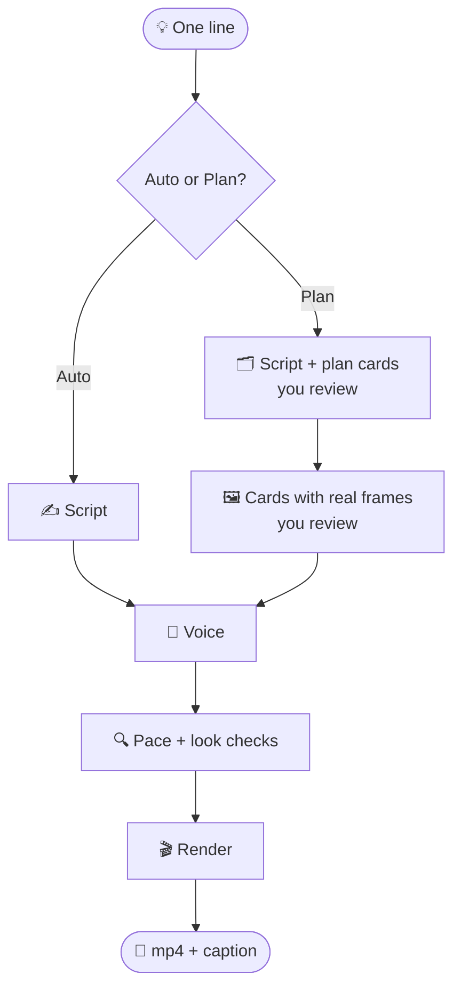

<div align="center">

# 🎬 Techno Reel

### Type one line. Get a finished Instagram reel. ✨

Script ✍️ → voice 🎤 → animation 🎞️ → captions 💬 → mp4 📱<br>
All on your Mac, all in code, no video editor.

[](https://www.remotion.dev)
[](https://react.dev)
[](https://www.typescriptlang.org)
[](https://nodejs.org)
[](#-get-started-once)
[](https://claude.com/claude-code)
[](LICENSE)

[🌐 Website](https://vekariya.ai.studio/) · [▶️ YouTube](https://www.youtube.com/@techno_ravan) ·
[📸 Instagram](https://www.instagram.com/techno_ravan) · [💼 LinkedIn](https://www.linkedin.com/in/nayan-vekariya/)


<sub>The example reel, shot by shot. Top: <b>flat</b> look. Bottom: <b>print</b> look with the paper host.</sub>

**[Quick start](#-get-started-once) · [First reel](#-make-your-first-reel) · [What to ask](#-what-you-can-ask-for) · [Voice](#-the-voice) · [Help](#-if-something-goes-wrong) · [About me](#-about-me)**

</div>

---

> 🔱 _Tech is like Ravan's knowledge: enormous power that serves you only if you steer it._
> This kit puts a writer, a voice, an editor and an animator on your Mac. You stay in charge.

## Local project workspace

Use Claude Code, Gemini CLI, or Codex chat to create and revise your reel. All assistants
follow `CLAUDE.md` through their repository instruction files. The dashboard is a local
preview page; it does not call an AI or run production jobs.

```sh
npm run project -- my-reel
npm run dashboard
```

Open http://127.0.0.1:4173. Drop originals into `projects/my-reel/raw/`, then ask your
assistant to plan or produce the reel. The page refreshes as files change.

```text
projects/my-reel/
  project.json  # name, AI-reported stage and next step
  raw/          # untouched originals
  preview/      # storyboard, draft.mp4 and shot stills
  export/       # my-reel.mp4, cover.png and caption.txt
  working/      # script, transcript, voice, assets and project scenes
```

Everything for one project stays together. `projects/` and `.local/` (tool caches, logs,
private host and generated render staging) are ignored by Git. Only the reusable tools,
dashboard and `examples/example/` template are shared. Git ignores do not prevent your
chosen AI service from receiving information you provide to it.

The dashboard shows project files, storyboards, shot lines, videos, captions, saved checks,
and AI-recorded approvals. Feedback and approvals happen in chat. It flags exports as
outdated when their working inputs change; migrated exports begin as unverified. It binds
only to localhost and has no uploads, accounts or cloud hosting. Copy the relative project
path from its page to navigate in your editor or file manager. MOV or unusual codecs may
need your system player; final H.264 MP4s play in the dashboard.

For an existing installation, run `npm run migrate` to preview the move, then
`npm run migrate -- --apply`. This copies files without deleting originals, checks for
conflicts before copying, and is safe to retry. `npm run migrate -- --rollback` removes
unchanged migration copies; edited copies block rollback. Empty folders and newly created
project metadata may remain. Keep old folders until you have checked your projects; new
commands use `projects/`. Legacy custom scenes need to be assigned to a project
(`working/scenes/`) and their relative imports updated.

The shipped example is copied into your private workspace automatically the first time
you run an example command. To preview a specific project in Remotion Studio, use
`npm run studio -- my-reel`; restart Studio to switch projects or refresh its staged assets.

## ✨ What it does

You type one sentence. You get a finished Instagram reel: animated, with a voice, captions and
sound. 1080×1920, ready to post.

- ✍️ **Writes the script.** Hook first, one idea per shot, 20–45 seconds.
- 🎤 **Records a natural voice.** Free and local, no cloud, no subscription.
- 🎞️ **Animates every shot in code.** Eleven scene types, two looks, a wipe at every cut and a
  snap zoom on the payoff word, all built with Remotion.
- 💬 **Adds word-by-word captions**, kept clear of Instagram's buttons.
- 🔊 **Scores it.** Real recorded sound effects on every beat and a music bed that dips under
  the voice. All public domain, so they're safe in paid work and monetised posts.
- 🗂️ **Plan mode.** See every shot as a card, then as a real picture, and change it. The voice is
  recorded and the video made only after you say OK.
- 🎥 **Edits your own video.** Cuts the "um"s, pauses and retakes out of a talking-head recording.
- 🧑‍🎨 **Hosted by you.** A cartoon of you can present every reel, its mouth moving with the voice.
- 🔍 **Checks its own work.** Pace and look checks on every shot before the final render, and a
  motion check on the finished video so nothing sits still.
- 🔒 **Local rendering and optional local voice.** ElevenLabs sends text to its cloud service.
  Your AI coding tool has its own data handling; see [privacy and downloads](#privacy-and-downloads).

## 🧭 How it works



---

## 🚀 Get started (once)

**You need:**

- 🍎 a Mac, ideally with an Apple chip (M1 or newer) for the free local voice
- 🟢 [Node.js](https://nodejs.org) 22.18 or newer (`brew install node`) and
  [Homebrew](https://brew.sh)
- 🤖 an AI coding tool: [Claude Code](https://claude.com/claude-code),
  [Gemini CLI](https://github.com/google-gemini/gemini-cli), Codex or Cursor. They use
  the same workflow (`CLAUDE.md`; `AGENTS.md` and `GEMINI.md` refer to it).

### Try the example first (no voice engine needed)

**Then, in the Terminal:**

```bash
git clone https://github.com/Nayan014/techno-reel.git
```

```bash
cd techno-reel
npm run setup -- --render-only
```

This installs the locked Node packages and headless Chrome, creates `.env` without overwriting
your settings, and checks rendering requirements. It skips voice downloads and voice checks.
Internet access is required for downloads and the fonts used by the renderer.

**Check it works** by making the example reel. Its voice is already recorded, so this takes
about a minute:

```bash
npm run render -- example
```

Open `projects/example/export/example.mp4`. That's the reel in the top row of the picture above.

### Enable voice for your own reels

```bash
npm run setup
```

Full setup uses `VOICE_PROVIDER` in `.env`. The default installs VoiceStudio and downloads its
packages and model (allow several GB of disk space and several minutes on the first run).
Setup runs `npm ci` every time to match `package-lock.json`; it preserves `.env` and reuses an
existing voice installation. It does not update that installation automatically.

| Environment | Support |
| --- | --- |
| Apple Silicon macOS | Primary supported environment for the full local workflow |
| Intel macOS | Local Kokoro via MLX is unavailable; select ElevenLabs or macOS `say` explicitly |
| Windows / Linux | Full workflow unverified; local MLX voice and macOS `say` are unavailable |

English is the default voice language. Other languages and cloning depend on the selected
engine and model; see [the voice](#-the-voice). Talking-head transcription requires VoiceStudio
even when another provider generates your voice. Homebrew ffmpeg adds noise reduction.

For an alternative provider, edit `.env` **before** full setup. `VOICE_PROVIDER=elevenlabs`
needs your own paid-service key and voice ID. `VOICE_PROVIDER=say` uses the Mac's robotic voice
with estimated caption timing. Neither selection installs VoiceStudio; there is no automatic
provider fallback.

---

## 🎬 Make your first reel

**Step 1.** Open the Terminal app, go to the folder and start your AI tool:

```bash
cd techno-reel && claude
```

(or `gemini`, `codex`, …)

**Step 2.** Tell Claude what the reel is about. For example:

```
make a reel about why coffee makes some people sleepy
```

**Step 3.** Claude asks: **Auto** or **Plan**?

| ⚡ Auto                                        | 🗂️ Plan                                                                         |
| --------------------------------------------- | ------------------------------------------------------------------------------- |
| Claude does everything on its own in minutes. | You review the reel twice before it's made.                                     |
| 1. writes the script                          | 1. Claude writes the script and shows a page of cards, one per shot             |
| 2. records the voice                          | 2. each card: what you see, what's said, the text on screen, which tool makes it |
| 3. builds the animations                      | 3. you reply with changes (`03: make it a big number`) until you like it        |
| 4. checks its own work and fixes problems     | 4. Claude draws every shot and shows the same cards with real pictures          |
| 5. saves the video                            | 5. you say OK, and only then it records the voice and saves the video           |

**Step 4.** Find your files in the reel's own folder, `projects/<name>/preview/`:

| File                     | What it is                                         |
| ------------------------ | -------------------------------------------------- |
| `projects/<name>/export/<name>.mp4`  | 🎬 the reel                                        |
| `projects/<name>/export/caption.txt` | 📝 the text for your Instagram post, with hashtags |
| `projects/<name>/export/cover.png`   | 🖼️ the hook as a cover image for the post          |
| `projects/<name>/preview/stills/`     | 🖼️ one picture per shot, from Claude's check       |
| `projects/<name>/preview/plan.html`   | 🗂️ the plan cards, in plan mode                    |

That's it. Post the video, paste the caption. 🎉

---

## 💬 What you can ask for

Just add it to your sentence. Some examples:

| You want             | Say this                                                                                                                |
| -------------------- | ----------------------------------------------------------------------------------------------------------------------- |
| 🧠 A topic           | `make a reel about how airplanes stay in the air`                                                                       |
| 📝 Your own words    | `make a reel from this script: ...` and paste your text                                                                 |
| 🎨 Other colours     | `use the cobalt palette`. Choices: **clay** (orange), **cobalt** (blue), **forest** (green), **mono** (black and white) |
| 🏷️ Your name on it   | `my handle is @yourname`                                                                                                |
| ⏱️ A shorter reel    | `keep it under 20 seconds`                                                                                              |
| 📊 A specific visual | `show 72% as a big number` or `compare iPhone vs Android`                                                               |
| 📋 A list            | `make it a top 3 list`                                                                                                  |
| ✂️ Paper look        | `use the print style`: cut-paper cards, a little paper presenter, captions that fill in as they're spoken               |
| 🎵 Music             | `use funk music` or `no music`. Choices: **lofi**, **upbeat**, **chill**, **funk**                                      |
| 🗂️ Plan it first     | `plan it first`: cards for every shot you can change before the voice is recorded and the video is made                 |
| 🧑‍🎨 You as the host   | `my own cartoon host`: a cartoon of you presents the reel (see [below](#-your-own-cartoon-host))                        |
| 🎥 Your own video    | `edit ~/Downloads/my-video.mov into a reel` (see below)                                                                 |

You can mix them:

```
make a reel about 3 sleep tips, cobalt palette, my handle is @sleepbetter, under 25 seconds
```

### 🎥 Edit your own video (talking head)

Record yourself talking (phone or camera, any length), then tell Claude where the file is:

```
edit ~/Downloads/my-video.mov into a reel, print style
```

Claude:

1. 🔊 levels your sound for Instagram and writes down every word you said, with its timing
2. ✂️ cuts out the "um"s, the pauses and the takes you redid, and keeps your best version of each line
3. 🔀 switches between your face, a zoomed-in face, and your face under a graphic (numbers, lists,
   your screenshots), so the cuts don't jump
4. 💬 adds captions and checks every shot, then saves the video

It only uses words you actually said. Want screenshots in it? Put them in the reel's folder and
say which line they go with. For noise reduction too, install the full ffmpeg once:
`brew install ffmpeg`.

---

## 🔁 Change a reel

Not happy? Just say what to change. Claude edits it and makes a new video.

```
make the first sentence punchier
replace shot 3 with a big number
use a different colour
make it shorter
the text in shot 2 is too long
```

> 💡 **New Claude session?** Claude doesn't remember old chats. Say the reel's name, for example
> `in the coffee-sleepy reel, make the hook punchier`. Every reel has its own folder in
> `projects/`. The folder name is the reel's name.

---

## 👀 Watch it before you post

Open the `.mp4` file in `projects/<name>/preview/`. It plays in QuickTime.

Or watch it in your browser, where you can move frame by frame:

```bash
npm run studio
```

On the right side, find the **slug** box and type the reel's name (for example `coffee-sleepy`).

---

## 🎤 The voice

The kit uses **VoiceStudio**, a free voice program that runs on your Mac. `npm run setup`
installs it into the `voicestudio/` folder inside the kit (an older install in `~/VoiceStudio`
is used if it's there).

- ✅ **You don't need to start it.** The kit starts it by itself when needed.
- ⏳ The first time it starts, it takes 5–30 seconds. After that, it stays on and is fast.
- 🗣️ The voice is **af_heart**, a natural American female voice.
- 🛑 **No robot voice.** If VoiceStudio won't start, the kit stops and Claude asks you what to
  do. It never quietly swaps in the Mac's built-in voice.

**Pauses and weight.** Claude marks each line so it doesn't sound read out in one breath:
`|` is a short beat, `||` a long pause, and `*words*` are said slower and heavier. For example
`Every cup pulls focus | *from tomorrow.*` The marks never show in the captions. To change the
rhythm, tell Claude things like `pause before "tomorrow" in shot 3` or `say "sleep" heavier`.

**Want a different voice?** Do this once:

```bash
open -e .env
```

A text window opens. Find the line `VOICESTUDIO_VOICE=af_heart` and change `af_heart` to
another voice. Save and close.

| Voice        | Sounds like          | Quality      |
| ------------ | -------------------- | ------------ |
| `af_heart`   | American woman       | ⭐ best      |
| `af_bella`   | American woman       | very good    |
| `af_nicole`  | American woman, soft | good         |
| `bf_emma`    | British woman        | good         |
| `am_michael` | American man         | okay         |
| `am_fenrir`  | American man         | okay         |
| `bm_george`  | British man          | okay         |

Then tell Claude `record the voice again` for your reel.

**Stop VoiceStudio** (to free memory, for example):

```bash
kill $(lsof -ti tcp:3900)
```

It starts again by itself next time you make a reel.

**Things this voice can't do:**

- 🇩🇪 **German.** This voice speaks English and a few other languages, but not German.
- 🧬 **Your own voice.** It can't copy your voice.

Both are possible with another voice model called OmniVoice. But its licence allows
**personal use only**, not paid or client work, and you have to accept that licence yourself.
Ask Claude if you want to switch.

---

## 🧑‍🎨 Your own cartoon host

The print look comes with a little paper presenter. You can swap it for a cartoon of **you**, in
either look. Ask Claude for `my own cartoon host`; it walks you through it:

1. 📸 Pick one clear photo of your face, in good light.
2. 🎨 Paste Claude's prompt into an image AI that takes a photo (Canva, ChatGPT, Gemini…). You
   get one picture with 8 poses of your cartoon on a pink background.
3. ✂️ Claude cuts it out with `npm run host -- <picture>` and sets where each mouth is.
4. 🎬 Every reel with `"host": "character"` now stars your cartoon. It changes pose on every
   shot and its mouth moves with the voice.

Your cartoon stays on your Mac in `.local/host/`, never in git. The host-cutting script processes the supplied image locally; using an image service to create it is your choice.

---

## 🩺 If something goes wrong

First, run the check:

```bash
cd techno-reel && npm run doctor
```

| Sign | Meaning                                   |
| ---- | ----------------------------------------- |
| ✓    | all good                                  |
| !    | works, but could be better                |
| ✗    | broken; the line below says how to fix it |

**Common problems:**

| Problem                           | Why                                                                | Fix                                                                                       |
| --------------------------------- | ------------------------------------------------------------------ | ----------------------------------------------------------------------------------------- |
| "VoiceStudio isn't answering"     | VoiceStudio didn't start, so no voice was recorded                 | Run `npm run doctor`. If VoiceStudio shows ✗, look at `.local/logs/voicestudio.log` or ask Claude |
| Captions are a bit early or late  | VoiceStudio's speech recognition didn't run, so timing was guessed | Run `npm run doctor`, then say `record the voice again`                                   |
| The first reel of the day is slow | The voice models are loading                                       | Normal. The next reels are fast                                                           |
| Text is cut off or too big        | A shot has too many words                                          | Tell Claude `the text in shot 4 doesn't fit`                                              |
| The Mac feels slow                | VoiceStudio uses memory while it runs                              | Stop it with the command in [The voice](#-the-voice)                                      |

---

## 🧰 Without Claude (advanced)

Every reel is one file: `projects/<name>/working/script.json`. Copy
`examples/example/script.json`, change the text, then run these one by one:

```bash
npm run voice -- <name>
```

Records the voice. For your own video, first run `npm run transcribe -- <name> <video>`, then
write shots that each play a `clip` of it (see `CLAUDE.md`); `voice` then cuts them instead.

```bash
npm run check -- <name>
```

Checks timing. Fix anything marked **FAIL**.

```bash
npm run stills -- <name>
```

Saves one picture per shot in `projects/<name>/preview/stills/` so you can look at them. Works before the
voice is recorded: a line without one is timed by estimate.

```bash
npm run plan -- <name>
```

Makes `projects/<name>/preview/plan.html`: one card per shot to review. Works before the voice is recorded.
Add `--frames` after `stills` to put the pictures on the cards. To plan first, go
`plan` → `stills` → `plan --frames`, change `script.json` until you like it, and only then run
`voice`, `check`, `render` and `pace`.

```bash
npm run render -- <name>
```

Makes the video at `projects/<name>/export/<name>.mp4`.

```bash
npm run pace -- <name>
```

Watches the finished video and lists every moment where nothing moves. Fix anything marked
**FAIL** (still for more than 1.2 seconds) and render again.

**The shot types** you can use in `script.json`:

| Shot type    | Shows                                           |
| ------------ | ----------------------------------------------- |
| `Hook`       | 🪝 big bold headline, for the first shot        |
| `Statement`  | 💡 one idea on a tilted card                    |
| `Stamp`      | 💥 one word slammed down with confetti          |
| `ChatPrompt` | 💬 a chat box where a prompt types itself in    |
| `BigNumber`  | 🔢 a number that counts up                      |
| `List`       | 📋 2–4 numbered points                          |
| `Compare`    | ⚖️ two things side by side                      |
| `Meter`      | 📈 a tank filling up: something building up     |
| `Swarm`      | 🕸️ one node spawning many: agents, teams, networks |
| `Screenshot` | 🖼️ your own screenshot or photo in a window     |
| `CTA`        | 👉 the ending: "Follow" button                  |

Every shot type works in both looks: `"style": "flat"` (bold outlines) or `"style": "print"`
(cut paper with a little presenter). `Statement`, `ChatPrompt`, `List` and `Swarm` can show the
logo of the product a shot is about (ChatGPT, Claude, Gemini, Cursor…) with `"icon"`. Claude
fetches the current official logo for each reel into the reel's folder, so the kit stores none.

Claude can also make new shot types when none fits. Those stay on your Mac in
`projects/<slug>/working/scenes/`, never in git, unless you ask to add one to the kit.

---

## 🧱 Built with

| Tool                                                                                     | Job                                                |
| ---------------------------------------------------------------------------------------- | -------------------------------------------------- |
| 🎞️ [Remotion](https://www.remotion.dev)                                                  | turns React code into video, frame by frame        |
| ⚛️ [React](https://react.dev) + [TypeScript](https://www.typescriptlang.org)             | every scene, caption and the paper host            |
| 🎤 [VoiceStudio](https://github.com/debpalash/VoiceStudio) + Kokoro                      | free voice and word timing, on your Mac            |
| 🔊 ffmpeg                                                                                | levels and cleans your own recordings              |
| 🤖 [Claude Code](https://claude.com/claude-code), Gemini CLI, Codex                      | the director: writes, checks and fixes every reel  |

---

## 📌 Good to know

- 💸 **Cost:** everything here is free except Claude itself. ElevenLabs (an optional paid voice)
  is only used if you add a key to `.env`.
- 📜 **Licences:** this kit is MIT (see `LICENSE`). Remotion (the video tool) is free for people
  and companies with up to 3 employees; bigger companies need a
  [Remotion company licence](https://www.remotion.dev/license). VoiceStudio is AGPL-3.0; setup
  downloads it separately, it isn't part of this repo. The af_heart voice model (Kokoro) has an
  Apache-2.0 licence label.
- 🔊 **Sounds and music:** every sound effect and music bed is CC0 (public domain): use them
  anywhere, no credit needed. They're from [Kenney](https://kenney.nl), [Freesound](https://freesound.org)
  and [HoliznaCC0](https://holiznacc0.bandcamp.com); `public/sfx/CREDITS.md` lists each one.
  Want trending Instagram audio instead? Say `no music` and add it in the Instagram app.
- 🔒 **Your reels stay private:** `.gitignore` keeps your own reels, recordings, renders and `.env`
  out of git. Only `examples/example/` is shared.
- 🎬 **Example:** `examples/example/` is a finished reel. Rebuild it with
  `npm run render -- example`.
- 🤖 **Instructions for Claude** are in `CLAUDE.md`. You don't need to read them.

---

## 👋 About me

<table>
<tr>
<td width="140" valign="top">

</td>
<td>

Hi, I'm **Nayan Vekariya** 👨‍💻, a Technical Lead and Software Architect with 10+ years of
building React Native and React apps that serve millions of users, across healthcare, e-commerce
and utilities. On the side I run **Techno Ravan**, a channel about AI and future tech.

- 🇩🇪 Based in Germany
- 📱 React Native · React · Next.js · TypeScript
- 🤖 Building with AI every day: Claude, Gemini, Cursor
- 🎥 Creator of [Techno Ravan](https://www.youtube.com/@techno_ravan): AI, tech guides, reviews
- 🗣️ English · Gujarati · Hindi

</td>
</tr>
</table>

[](https://vekariya.ai.studio/)
[](https://www.youtube.com/@techno_ravan)
[](https://www.instagram.com/techno_ravan)
[](https://www.linkedin.com/in/nayan-vekariya/)
[](https://medium.com/@nayan.vekariya014)
[](https://www.upwork.com/freelancers/~01c4ffd8f428873af2)

---

<div align="center">

⭐ **If Techno Reel saved you an evening in a video editor, star the repo** and tag
**@techno_ravan** in your reel. I'd love to see it!

Made with ❤️ and a lot of ☕ in Germany 🇩🇪 by [Nayan Vekariya](https://vekariya.ai.studio/)

</div>


## Privacy and downloads

Rendering is local. Setup downloads npm packages, Chrome, and (for the default full setup)
VoiceStudio and model files. Rendering loads Google Fonts; fetching logos and restoring sound
assets also requires internet access. Offline operation is not guaranteed.

The default voice and transcription use the configured VoiceStudio endpoint (loopback by
default). ElevenLabs sends spoken text to ElevenLabs. Your AI coding assistant may process
prompts and repository content remotely under its own settings and terms. The cartoon-host
workflow may involve an image service you choose; review what you submit to that service.

`.env`, generated reels, renders, local scenes and custom hosts are ignored by Git. Keep
personal source recordings outside tracked folders; ignore rules do not protect arbitrary
files you add elsewhere or anything already committed. Never attach keys or private takes to
public bug reports.

## Licenses and contributing

The kit's own code is MIT licensed. Dependencies, voice models, fonts and media retain their
own terms. See [third-party notices](THIRD_PARTY_NOTICES.md) before commercial or client use.

For development and bug reports, see [CONTRIBUTING.md](CONTRIBUTING.md). For sensitive reports,
see [SECURITY.md](SECURITY.md).

Current validation and remaining platform limits are recorded in
[the release check](docs/release-check.md). Studio may print a Zod version warning because
this kit uses a security-patched version ahead of Remotion's pinned dependency; see
[the dependency note](CONTRIBUTING.md).
