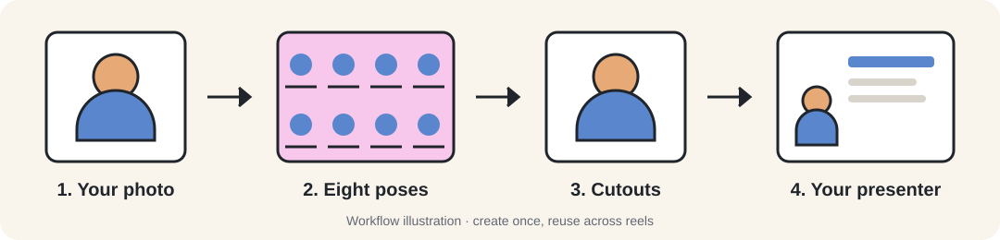

[← Getting started](../README.md)

# Create your own avatar

Give your reels a cartoon presenter based on you. It changes pose between shots and animates
its mouth with the voice. Set it up once and reuse it in either visual style.



**1. Make the character sheet.** Ask your assistant: `Help me create my own cartoon host`.
It gives you a prompt to use with a clear, front-facing photo in an image service of your choice.
The result should be one **4×2 sheet of eight poses**, with a closed mouth and a solid magenta
background. The poses are idle, pointing, presenting, thinking, shrugging, shocked, cheering
and waving. You choose where to upload your photo.

**2. Import the sheet.** Save the full-size image locally and give your assistant its path:

```bash
npm run host -- /path/to/character-sheet.png
```

The tool removes the magenta and saves the poses in `.local/host/`. Your assistant checks the
cutouts and adjusts mouth positions using `.local/cache/host/check.png`.

**3. Use your presenter.** Ask: `Use my cartoon host in this reel`. The assistant sets
`"host": "character"` in the reel's script and checks the result in the shot previews.

The avatar is a cartoon with animated poses and a mouth overlay. Its appearance and voice
are configured separately; to use your voice too, see [voice cloning](voice.md#voice-cloning-and-other-languages).
Your character files stay in `.local/host/`, which is ignored by Git.

For the full image prompt and pose setup, see the [cartoon-host guide](../.claude/skills/cartoon-host/SKILL.md).
