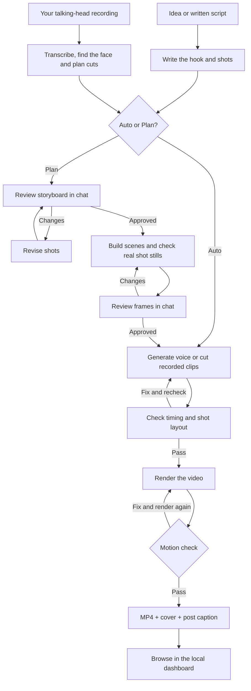

[← Getting started](../README.md)

# What can you make?

| Reel type | What it looks like | Try asking |
| --- | --- | --- |
| **Paper-style explainer** | Cut-paper cards, textured backgrounds and a paper presenter. | `Explain 3 sleep tips in print style` |
| **Bold animated reel** | Big headlines, hard shadows, numbers, lists and comparisons. | `Make a flat-style reel comparing two ideas` |
| **Talking head** | Your recording, trimmed and reframed, with captions and supporting graphics. | `Edit ~/Downloads/my-video.mov into a reel` |
| **Avatar-led reel** | Your custom cartoon presenter alongside animated scenes, in either style. | `Make an explainer with my cartoon host` |
| **Demo or walkthrough** | Your screenshots alongside headlines, steps and voiceover. | `Use these screenshots to explain my app` |

**Styles and presenters work together:** `flat` and `print` control the visual design;
a custom avatar replaces the presenter in either style. The print style includes a paper host
by default, which you can hide.

Talking-head edits use your spoken words, trim fillers and retakes, and alternate face shots
with graphics. Transcription requires VoiceStudio; Homebrew ffmpeg adds noise reduction.

Personalise any reel with **clay, cobalt, forest or mono** colours, your @handle, and
**lofi, upbeat, chill or funk** music. Ask for `no music` if you will add audio on Instagram.
The assistant checks timing, shot layout and motion during production.

## How the workflow works

Start with an idea, a script or your own recording. Your AI assistant runs the steps;
in Plan mode, you review the storyboard and real frames before production continues.

View the production workflow

In Plan mode, talking-head clips are cut before frame review so previews use your actual
footage. Generated voice waits for frame approval. If a fix changes an approved shot,
the assistant brings its updated frames back for review before rendering.
